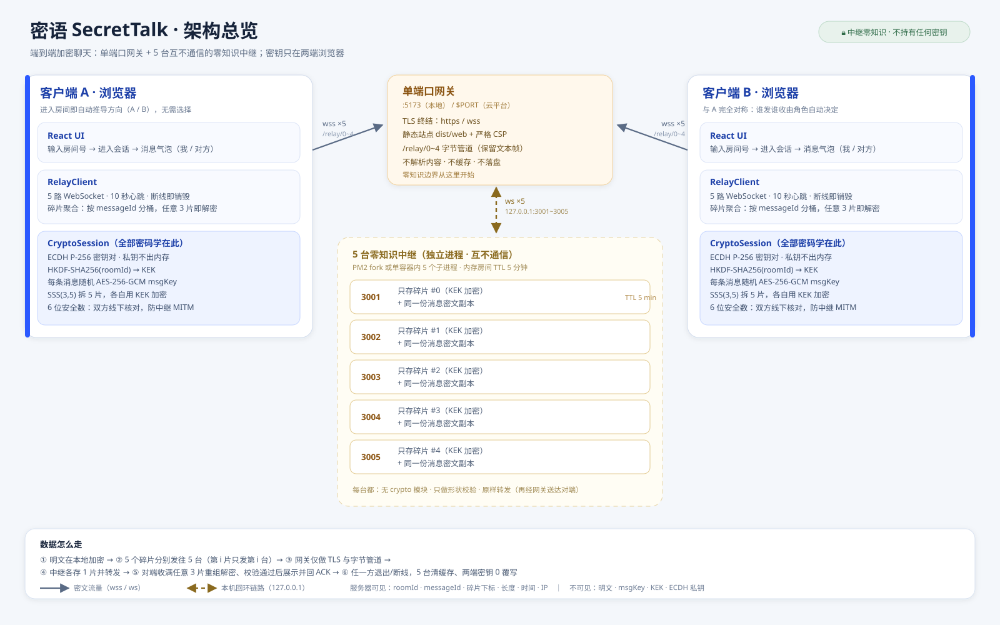
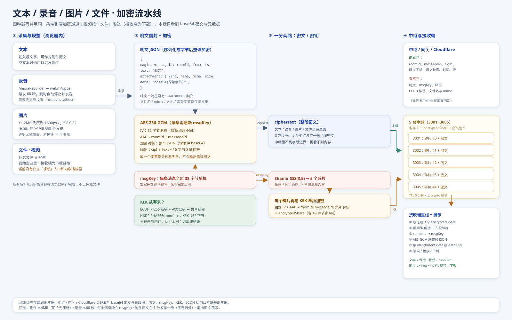
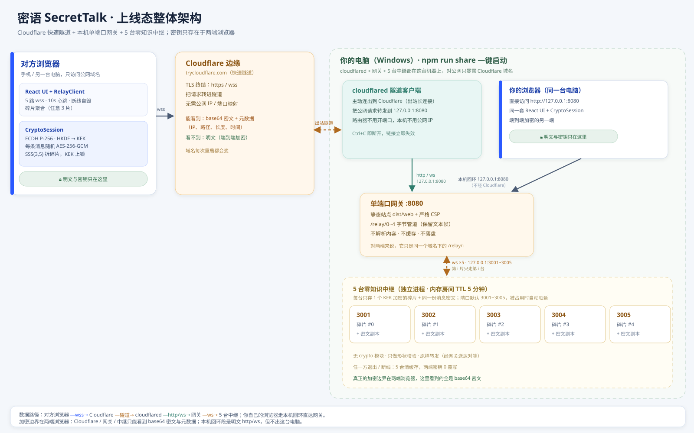
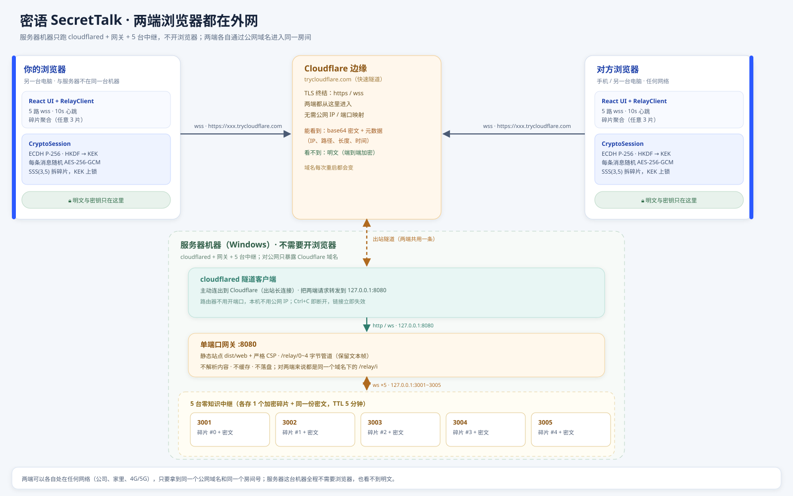

# 密语 · SecretTalk

> 零知识中继 + 混合密码学的端到端加密聊天。
> 中继服务器只做「接收 → 内存暂存 → 转发」，不参与任何加解密、密钥生成或 SSS 拆分重组。

---

## 一、架构总览



> 矢量原图：[docs/architecture.svg](docs/architecture.svg)；位图：[docs/architecture.png](docs/architecture.png)（1600×1000 @2x）。

一句话流程：**明文在两端浏览器内加密 → 5 个碎片分别发往 5 台中继 → 网关只做 TLS 与字节转发 → 对端收满任意 3 片重组解密、校验通过后回 ACK**。中继全程只见 base64 密文，KEK / msgKey / ECDH 私钥从未离开浏览器。

> 另有一条**独立**的实时通道：**语音通话走 WebRTC P2P**（浏览器强制 DTLS-SRTP 加密），信令借中继转发，媒体流不经过 5 台孤岛，也不套用上面的 SSS/AES-GCM 封装。

**关键约束**：5 个 Node.js 进程之间没有任何 IPC、共享内存、数据库或文件交换。每个进程的房间表是闭包局部变量（`startRelayServer` 内），因此即便测试在同一进程里拉起 5 个实例，它们也不会共享任何状态。

---

## 二、密码学流程

### A 端发送（一次一密）

| 步骤 | 操作 | 说明 |
|---|---|---|
| 1 | 生成 ECDH P-256 密钥对 | 运行时私钥 `extractable:false`；另导出一份可覆写的 PKCS8 副本用于销毁时 `fill(0)` |
| 2 | 交换 SPKI 公钥 + 计算 6 位安全数 | 中继只转发不解析；安全数需双方线下核对以抵御 MITM |
| 3 | `deriveBits` → HKDF-SHA256 → KEK | salt = SHA-256(roomId)，info 绑定 roomId，杜绝跨会话密钥复用 |
| 4 | 生成随机 32 字节 `msgKey` | 每条消息一把新密钥，用完立即覆写 |
| 5 | AES-256-GCM 加密明文封装 | 封装含 `magic / messageId / roomId / from / ts / text`，AAD 绑定 roomId+messageId |
| 6 | `split(msgKey, 5, 3)` 得到 5 个碎片 | SSS 只在客户端本地执行 |
| 7 | 每个碎片用 KEK 单独加密 | 独立 12 字节 IV，AAD = `roomId\|messageId\|shareIndex`，把碎片与端口下标强绑定 |
| 8 | 碎片 #i 只发往 `servers[i]` | 消息密文在 5 路冗余，保证任意 3 路都同时带密文 |

### B 端接收

1. 按 `messageId` 聚合碎片，严格校验 `shareIndex === 端口下标`，按 index 去重，绝不混用不同消息的碎片；
2. 累计 ≥ 3 片 → 用 KEK 解密（GCM tag 顺带完成碎片完整性 + AAD 上下文校验）；
3. `combine()` 重组出 32 字节 `msgKey`；
4. **尝试解密消息密文**：AES-GCM 的 128bit 认证标签会验证密钥是否正确、密文是否被改——这是需求要求的「碎片完整性最终校验」，绝不能用「重组成功」代替「解密成功」；
5. 二次校验明文封装里的 magic / messageId / roomId；
6. 全部通过才展示明文并广播 `ACK(messageId)`；发送端按 messageId 去重后更新为「已读」；
7. 无论成功失败，`finally` 中 0 覆写重组密钥、明文、所有明文碎片。

> **注意**：`shamir-secret-sharing` 的 `combine()` 不会校验门限——喂 2 片它会「成功」返回一段长度合法但错误的 32 字节。因此前端必须先做 `size >= 3` 检查，再靠 GCM 兜底。测试里专门覆盖了这一点。

### 附件（语音消息 / 图片 / 文件）

附件和文字走同一条加密通道，没有独立的「文件服务器」：

1. 浏览器把文件读成字节 → 放进明文 JSON 封装的 `attachment` 字段（base64）；
2. 和文字一起用这条消息的 `msgKey` 做 AES-256-GCM 加密；
3. 之后照旧拆碎片、发 5 路；中继只看到更大的密文；
4. 接收端解密后才还原成 data URL，交给 `` / `<audio>` / 下载链接。

约束与实现：

- 单个附件上限 **4MB**（`MAX_ATTACHMENT_BYTES`）；图片超过约 1.2MB 会先压到最长边 1600、JPEG 0.82，避免手机直出照片打爆中继内存；
- 语音用 `MediaRecorder` 录制，最长 **60 秒**，需要麦克风权限（网关的 `Permissions-Policy` 已放开 `microphone=(self)`，CSP 放了 `media-src data: blob:`）；
- **视频目前没有独立入口**：按「文件」发送，接收端是下载链接，不是内嵌播放器（4MB 上限下也不适合放长视频）；
- 附件随消息密文在 5 台中继**各存一份**（不是拆 5 份），文件越大内存成本越明显；
- 附件同样只在两端与中继内存里，房间销毁即清空，不落盘。



> 矢量原图：[docs/encryption-pipeline.svg](docs/encryption-pipeline.svg)；位图：[docs/encryption-pipeline.png](docs/encryption-pipeline.png)。

### 语音通话（WebRTC P2P）

和「语音消息」是两件事：语音消息走上面的 5 路加密通道；**语音通话是实时媒体流**。

- **信令**（offer / answer / ICE / hangup / reject）通过现有中继原样转发，中继能看到 SDP 与 ICE 候选（含 IP），但**看不到声音**；
- **媒体**走 WebRTC P2P，由浏览器强制 **DTLS-SRTP** 加密，不经过 5 台中继；
- 本阶段**没有**接入应用层 E2E 封装（不套 SSS/AES-GCM），UI 上标注为「WebRTC P2P，不经过中继」；
- 只使用公共 STUN（Cloudflare / Google），**没有 TURN**：对称 NAT / 严格公司网络下可能连不通，会明确报错；
- UI 支持：呼叫 / 接听 / 拒绝 / 忙线提示 / 静音 / 挂断 / 通话计时；同一时间只保留一路通话。

---

## 三、零知识边界

| 项目 | 中继服务器能看到 | 中继服务器拿不到 |
|---|---|---|
| 消息内容 | base64 密文字符串 | 明文、AES 密钥、任何解密能力 |
| 密钥碎片 | 1 个用 KEK 加密的碎片（每台各 1 个） | KEK、ECDH 私钥、≥3 个碎片 |
| 元数据 | roomId、messageId、shareIndex、from、时间戳、IP、连接时序 | 参与方真实身份 |
| 代码层面 | 只有 `isCipherPacket()` 形状校验 | `server.ts` 不 import 任何 crypto 模块，无 subtle 调用，不落盘 |

测试 `tests/server.test.ts` 里有一条**静态源码断言**：检查 `server.ts` 不含 `node:crypto`、`subtle.decrypt/encrypt/deriveBits`、`writeFileSync` 等，防止后续维护者无意中破坏零知识边界。

---

## 四、目录结构

```
SecretTalk/
├── shared/protocol.ts          # 前后端共享的报文类型、常量、房间/消息 ID 生成
├── src/
│   ├── crypto.ts               # ① 密码学核心（ECDH/HKDF/AES-GCM/SSS/擦除）
│   ├── relay.ts                # ② 5 路 WebSocket 管理（分发/聚合/ACK/心跳/自毁）
│   ├── voice.ts                # ⑤ WebRTC 语音通话（P2P，DTLS-SRTP）
│   ├── media.ts                # 附件压缩 / 读取
│   ├── App.tsx                 # 移动端优先的 React UI
│   ├── main.tsx
│   └── styles.css
├── server/server.ts            # ③ 零知识中继（process.env.PORT 动态监听）
├── tests/
│   ├── helpers.ts              # 拉起 N 台真实 ws 实例 + Node 端 WebSocket 工厂
│   ├── crypto.test.ts          # ④ 密码学单元测试（20 例）
│   ├── server.test.ts          # ④ 中继行为测试（14 例）
│   ├── gateway.test.ts         # ④ 单端口网关测试（11 例）
│   ├── ua.test.ts              # ④ 内置浏览器识别（4 例）
│   └── e2e.test.ts             # ④ 端到端流程测试（8 例）
├── ecosystem.config.cjs        # PM2：fork 模式启动 3001~3005 五个独立进程
├── vite.config.ts / vitest.config.ts
├── tsconfig.json / tsconfig.server.json
└── package.json
```

---

## 五、快速开始

```bash
cd SecretTalk
npm install            # pm2 / node-forge 均为项目本地依赖，无需全局安装
npm run start:all      # 构建前后端 + 自动生成自签证书 → 起 5 台中继 + 1 个 TLS 网关
npm run status:all     # 查看进程
npm run stop:all       # 全部停止（触发各进程 SIGTERM 清理）
```

> **关于 PM2**：`pm2` 写在 `dependencies` 里，npm 执行 scripts 时会自动把 `node_modules/.bin`
> 注入 PATH，因此 CMD / PowerShell / Git Bash、任意 Node 版本都能直接调用，
> 不会再出现 `'pm2' 不是内部或外部命令`。前端静态站点也已并入 `ecosystem.config.cjs`，
> 启动与停止各只需一条命令，规避 CMD 下多命令拼接的兼容问题。

前端与 WebSocket 入口由**单端口零知识网关**（`server/gateway.ts`）统一提供：
`https://<IP>:5173/` 出页面（带严格 CSP / X-Frame-Options 等安全头），
`wss://<IP>:5173/relay/0~4` 透明反代到本机 5 个独立中继进程。
网关只做 TLS 终结 + 字节管道，不解析、不缓存任何帧，不 import 任何密码学模块——
它与中继同级，和中继一样「看得见密文碎片、看不见明文与密钥」，5 个独立进程的孤岛语义不变。

> 构建目录已隔离：前端输出 `dist/web`，后端输出 `dist/server` 与 `dist/shared`，避免 `vite build` 的 `emptyOutDir` 把 server.js 清掉。
> PM2 daemon 独立于终端运行，关掉命令行也不会中断服务；重复执行 `start:all` 前请先 `stop:all`。

### 注意：安全上下文（Secure Context）与 WebCrypto

`crypto.subtle` **只在安全上下文中存在**：

| 页面地址 | `crypto.subtle` | 能否加密 |
|---|---|---|
| `https://任意域名` | 有 | 可用 |
| `http://localhost` / `http://127.0.0.1` | 有 | 可用（浏览器把回环地址视为潜在可信） |
| `http://192.168.x.x`、`http://<局域网 IP>`、普通 `http://域名` | **undefined** | **不可用** |

在非安全上下文里 `window.crypto` 对象仍在，但 `crypto.subtle === undefined`，
于是 `crypto.subtle.generateKey(...)` 抛出
`Cannot read properties of undefined (reading 'generateKey')`。
这不是代码缺陷，而是浏览器的强制保护：明文 HTTP 下页面脚本本身都可能被中间人替换，
此时提供加密 API 只会制造虚假的安全感。
本项目现在会在进入会话前检测并显示醒目中文提示，同时禁用「进入会话」按钮
（`webCryptoUnavailableReason()`，错误码 `INSECURE_CONTEXT`）。

**因此当前纯 HTTP 局域网部署只能用于：**
- 电脑本机 `http://localhost:5173` 完整演示（开两个标签页，填同一个房间号即可，不用选 A / B）；
- 验证 5 台中继的网络连通性、健康检查、`ping/pong`。

**手机上真正可用，需要同时满足两条**（缺一不可）：

1. 页面走 `https://`；
2. 5 条中继同步升级为 `wss://` —— 因为 **https 页面连接 `ws://` 会被浏览器按混合内容直接拦截**。

> 绝对不要用纯 JS 的 AES/ECDH polyfill 去「绕过」这个限制：那等于把密钥交给一个
> 可被注入的明文页面，直接摧毁端到端加密的前提。前端 `wsScheme` 已按
> `location.protocol` 自动选择 `ws` / `wss`，为 TLS 改造预留好了开关。

可选路径：

| 方案 | 说明 | 适用 |
|---|---|---|
| **局域网自签 HTTPS 网关（已内置）** | `npm run start:all` 后手机访问 `https://<电脑IP>:5173`，浏览器提示不安全时点「高级 → 继续访问」即可获得完整加密能力 | **手机 / 局域网，开箱即用** |
| 安装根 CA（可选，消除警告） | 手机浏览器打开 `https://<电脑IP>:5173/ca.crt` 下载并信任 `SecretTalk Local CA` | 想每次都无警告 |
| 公网 HTTPS + 单端口 WSS 网关 | 前端托管在 PaaS（自动正规证书），同一个网关进程直接上云 | 随时随地可用 |

> 为什么同源网关能解决 wss 问题：浏览器对自签证书的「继续访问」豁免按 origin 记忆。
> 页面与 5 条 `wss://` 连接同 host 同端口（`/relay/i` 路径区分），豁免对所有同源请求生效；
> 若像旧方案那样直连 `wss://IP:3001~3005`，跨端口无法豁免，握手必被拦截。

**其他命令**：

```bash
npm run dev            # Vite 开发服务器（http://localhost:5173，热更新）
npm run start:pm2      # 只编译后端并起 6 个进程（不重新构建前端）
npm run build          # 前端产物 dist/web/
npm run build:server   # 后端产物 dist/server/server.js + dist/shared/protocol.js
npm test               # 57 个用例
```

**只起一台（调试用）**：

```bash
PORT=3003 RELAY_INDEX=2 npx tsx server/server.ts
# 或编译后
PORT=3003 RELAY_INDEX=2 node dist/server/server.js
```

### 会话内常驻模式（受限环境备用）

某些执行沙箱会在命令结束时回收它派生的整个进程树，导致 PM2 daemon 被杀、中继随之断开。
此时改用 `npm run start:local`：由 `scripts/start-local.cjs` 直接 spawn 出 **5 个独立 Node 进程 + 1 个静态站点进程**，
孤岛语义不变（每台仍独占自己的 `PORT` 与 `RELAY_INDEX`、互不共享 rooms），只是不用 PM2 托管。

### 本机部署实测（2026-11-13）

- 局域网 IP：`192.168.0.101`，手机访问 **`https://192.168.0.101:5173`**（点「继续访问」）
- 7 个进程：5 台中继 `ws://127.0.0.1:3001~3005`（碎片下标 0~4）+ 1 个 TLS 网关 `https://0.0.0.0:5173`
- TLS 全链路验证：`https://192.168.0.101:5173/` 与 `https://localhost:5173/` 用 CA 校验均 200；
  `wss://…/relay/0~4` 五路 ping/pong 全通（via=3001~3005）；5 台中继 `zeroKnowledge=true`
- 证书：`npm run gen:certs`（node-forge 纯 JS 生成，SAN 覆盖本机全部内网 IPv4 + localhost；
  换 Wi-Fi 后 IP 变化时执行 `npm run gen:certs -- --force`）
- 旧结论修正：此前「手机直连 `http://<IP>:5173`」的方案因非安全上下文（`crypto.subtle` 为
  undefined）**无法加密**，已被自签 HTTPS 网关方案取代

> 公网部署：网关已把页面与中继收进单端口，部署到任何只暴露一个端口、要求 `wss://` 的
> PaaS（Railway / Render / Fly.io 等）时，把 `GATEWAY_TLS` 关掉（由平台前置的正规证书
> 负责 TLS），其余零改动；网关只路由，不接触密钥，不破坏 5 个独立进程的拓扑。

---

## 六、测试覆盖

`npm test` 会真实拉起 5 个 `ws` 服务实例（用 `port: 0` 由系统分配端口，避免占用），跑真实 WebCrypto，**不使用任何 mock**：

- `crypto.test.ts`（20 例）：Base64 往返与类型、0 覆写、SSS 全部 10 种 3 片组合、2 片无法还原、ECDH/SAS 一致性、任意 3 路解密、碎片篡改、AAD 跨端口重放、密文篡改、跨消息碎片混用、房间/KEK 隔离、destroy 后禁用、raw AES 密钥即时擦除、附件字节级往返、超大附件拒绝。
- `server.test.ts`（14 例）：源码级零知识断言、5 实例状态隔离、心跳、公钥双向转发、密文转发、pull 拉取、ACK 转发、语音通话信令转发、错误端口拒绝、第三人被拒（ROOM_FULL）、force_exit 清缓存、close 清缓存、TTL 过期、close 后端口可复用。
- `gateway.test.ts`（11 例）：微信内置浏览器拦截（403 / WS 拒绝 / 可关闭）、`/relay/{i}` 路由、**文本帧保持文本帧**（防止浏览器拿到 Blob）、ping/pong 透传、越界路径拒绝、断开语义穿透、静态站点与安全头、目录穿越防护、TLS 同端口。
- `ua.test.ts`（4 例）：微信 / 企业微信 / 微信桌面版的 UA 识别，以及普通浏览器与空 UA 不误伤。
- `e2e.test.ts`（8 例）：附件经 5 路中继完整送达、只填同一房间号即可入房 + 角色自动推导 + 双向收发、完整「A 发 5 片 → B 收 3 片解密 → ACK 已读去重 → force_exit 全链路自毁」、仅 3 台中继在线仍可解密、断线触发 force_exit 并清空 5 台缓存、完整性失败不误报已读、后台标签页收不到 pong 不误判心跳超时、前台仍会正常判死。

当前结果：`5 files / 57 tests passed`，前后端 `tsc --noEmit` 均通过，前后端构建通过，5 实例 + `env.PORT` 冒烟通过，浏览器（两个标签页）真实互通 + 图片/语音消息 + WebRTC 语音通话验证通过。

---

## 七、帧协议速查

| 方向 | 帧 | 作用 |
|---|---|---|
| C→S | `hello` | 入房 + 携带 ECDH SPKI 公钥（**不携带角色**：房间号即唯一凭证） |
| C→S | `ping` / `pull` | 应用层心跳 / 拉取本进程暂存碎片 |
| C→S | `cipher` | 投递第 i 个碎片包（只发往 servers[i]） |
| C→S | `ack` | B 解密成功后的已读回执（含 messageId） |
| C→S | `force_exit` | 主动退出指令 |
| S→C | `welcome` / `peer_key` | 入房确认 / 转发对端公钥 |
| S→C | `cipher` / `cached` | 实时转发 / pull 响应 |
| S→C | `ack` / `pong` | 转发回执 / 心跳响应 |
| S→C | `force_exit` / `room_expired` | 通知销毁 / TTL 到期重新登记 |

服务器另有 `ws` 原生 ping 帧探测半开连接；客户端另有 JSON 心跳 + 看门狗，二者互补（浏览器 WebSocket 无法主动发 ping 控制帧）。

---

## 八、关键设计决策与安全权衡

1. **ECDH 不是加密算法**。需求写的「ECDH 加密/解密密钥碎片」在工程上应实现为：ECDH 协商共享秘密 → HKDF 派生 KEK → AES-GCM 包裹碎片。直接用 ECDH「加密」数据是不可行的，本项目按标准做法实现。
2. **AAD 绑定下标**。碎片密文的 `additionalData = roomId|messageId|shareIndex`，中继把碎片挪到别的端口或跨消息重放都会被 GCM 判为篡改。
3. **完整性三重校验**：碎片 GCM tag → 重组密钥解消息密文的 GCM tag → 明文封装 magic/上下文。篡改碎片、篡改密文、碎片错配、会话密钥不一致分别报不同错误码，便于诊断。
4. **生命周期自毁**：`strictExitOnAnyClose` 默认 `true`，5 路中任一路断开即全局 `force_exit`；服务器侧任一 `close` 事件也会清空该 room 缓存并通知另一方，双保险。若追求可用性可设为 `false`（仅全部链路都断才销毁）。`beforeunload`/`pagehide` 做本地兜底；手机切后台**不**触发自毁，避免移动端误杀。
5. **内存防泄漏**：服务器每次刷新 TTL 都先 `clearTimeout`；房间销毁/进程退出清空所有定时器与密文包；前端碎片收集器每个 messageId 挂 60s 回收定时器并在凑齐/销毁时 `clearTimeout`；`force_exit` 清除心跳与看门狗 `setInterval`。
6. **Base64 只作传输编码**：`toB64/fromB64` 仅用于网络序列化，客户端收到立刻转回 `Uint8Array` 再交给 WebCrypto，绝不把 base64 当作安全措施。
7. **角色不需要用户选择，也不能由中继分配**：网页端只保留「房间号」一个输入。双方交换 ECDH 公钥后，各自在本地按公钥字节字典序比较（小者为 A、大者为 B），因此必然得到相反的角色；若交给 5 台互不通信的中继「先到先得」分配，同一个人在不同中继上可能拿到不同角色，协议会直接错乱。房间容量改由中继守「最多两人」（第三人返回 `ROOM_FULL`），旧实现中「两端都选 A」的 `ROLE_TAKEN` 分支已随选项一并删除。

### 必须知道的局限（生产化清单）

| 局限 | 说明 / 建议 |
|---|---|
| **JS 无法真正擦除内存** | V8 GC 副本、不可变字符串、CryptoKey 内部内存都不受 JS 控制。本项目的 `fill(0)` 覆盖所有可寻址字节 + 运行时密钥 `extractable:false` 是工程最优，但抗取证请用 WASM + `mlock` / 原生客户端，并禁用 swap。`WIPE_EXTRACTABLE_PRIVATE_KEY=false` 可切到「私钥永不导出」的更严格模式。 |
| **无前向保密** | 当前是会话级 ECDH，不是逐消息棘轮。长期会话泄露 KEK 会危及历史消息；生产建议引入 Double Ratchet（Signal 协议）。 |
| **无抗重放** | GCM 只防篡改不防重放。恶意中继可重放旧密文包，B 端会再次解密成功。应增加单调递增序号 + 已处理 messageId 去重窗口。 |
| **元数据泄露** | 同一 `messageId` 同时出现在 5 台中继，可被流量关联；IP、时序、房间号也可见。可考虑填充包、随机延迟、每路独立 messageId 别名。 |
| **MITM 依赖带外核对** | 零知识中继可以替换 ECDH 公钥。6 位安全数（SAS）必须双方线下核对；生产可加 PAKE / 二维码互扫 / 证书绑定身份。 |
| **XSS = 全盘失守** | 密钥在 JS 堆里，任何脚本注入都能直接读取。必须部署严格 CSP、Trusted Types，最好放在独立 origin 且无第三方脚本。 |
| **传输层** | 示例用 `ws://`，生产必须 `wss://` + HSTS；单机 5 进程只是**拓扑模拟**，真正的安全增益需要 5 台不同物理机 / 不同信任域 / 不同运维方。 |
| **无持久化** | 断线即丢消息（这是「生命周期自毁」的设计取舍），也不支持离线消息与群聊。 |
| **门限靠前端保证** | `combine()` 自身不校验 k，前端门限检查 + GCM 校验缺一不可。 |

---

## 九、配置项

| 位置 | 变量 | 默认值 | 说明 |
|---|---|---|---|
| 服务端 env | `PORT` | 3001 | **动态监听端口**，PM2 为 5 个进程分别注入 3001~3005 |
| 服务端 env | `HOST` | 0.0.0.0 | 监听地址 |
| 服务端 env | `RELAY_INDEX` | -1 | 本进程负责的碎片下标，用于拒绝投错端口 |
| 服务端 env | `ROOM_TTL_MS` | 300000 | 内存房间 TTL |
| 服务端 env | `BLOCK_WECHAT` | 1 | 为 `0` 时允许微信 / 企业微信内置浏览器访问（仅调试用；默认拒绝） |
| 服务端 env | `DEBUG_FRAMES` | 关闭 | 设为 `1` 时把收到的密文包（base64）写入 PM2 日志，仅用于验证「中继转发的是密文」；会累积元数据，验证完请关闭并 `pm2 flush` |
| `shared/protocol.ts` | `SHARE_TOTAL / SHARE_THRESHOLD` | 5 / 3 | SSS 门限 |
| `shared/protocol.ts` | `MAX_ATTACHMENT_BYTES` | 4 MB | 单个附件上限（原始字节；图片超过约 1.2MB 会先压缩） |
| `shared/protocol.ts` | `HEARTBEAT_INTERVAL_MS / TIMEOUT_MS` | 10000 / 8000 | 客户端心跳 |
| `RelayConfig` | `strictExitOnAnyClose` | true | 任一路断开是否立即销毁会话 |
| `src/crypto.ts` | `WIPE_EXTRACTABLE_PRIVATE_KEY` | true | 是否保留可 0 覆写的 ECDH 私钥副本 |

---

## 十、几个容易踩的坑

- **5 个进程绝不能共享 `rooms`**：本项目用闭包局部变量，测试已断言「往 3001 写数据后其余 4 台 rooms 为空」。
- **碎片下标必须和端口一一对应**：`shareIndex=i` 只能发往 `servers[i]`，否则 AAD 校验失败（这是刻意设计）。
- **不同 messageId 的碎片不能混进 `combine()`**：客户端按 messageId 分桶，否则得到错误密钥且难以定位。
- **少于 3 片时 `combine()` 不抛错**：必须自己做门限检查，并用 GCM 解密作为最终判据。
- **消息密文要在 5 路冗余**：否则「任意 3 路」可能凑不齐密文。
- **ACK 会重复 5 份**：接收端向 5 路广播，发送端按 messageId 去重，只更新一次「已读」；只有本端发出过的消息才接受回执（双向对称，不偏向某一端）。
- **网关必须保留帧类型**：`ws.send(Buffer)` 默认发**二进制帧**。中继发的 JSON 全是文本帧，网关若用 `send(data)` 原样转发，浏览器会按默认 `binaryType='blob'` 收到 Blob，`JSON.parse` 全部失败——症状是「握手永远不完成、日志刷『收到无法解析的帧』、约 20 秒后心跳超时自毁」。网关现在用 `send(data, { binary: isBinary })` 保留类型；客户端还把 `binaryType` 固定成 `arraybuffer` 并对 Blob 兜底，二者缺一都会复发。
- **后台标签页不能按「多久没 pong」判死**：浏览器会把后台标签页的定时器节流到秒级/分钟级，沉默不代表断链。看门狗在 `document.hidden` 时只重建基线不判死，页面恢复可见/bfcache 恢复时补发 ping；真正的断线交给服务器 `ws` 原生 ping 超时与 `close` 事件兜底。
- **自己 `close()` 也会触发 `onclose`**：用 `intentionalClose` 标志避免 force_exit 指令风暴。
- **附件不是分片存储**：密文（含附件的 base64）在 5 路各一份；只有 `msgKey` 拆 5 份。附件越大，5 份副本的内存成本越高，所以上限压到 4MB、图片先压缩。
- **录音需要安全上下文**：`getUserMedia` 只在 https / localhost 可用；网关已把 `Permissions-Policy` 的麦克风放开，若用旧浏览器（无 MediaRecorder）会给出明确提示而不是静默失败。

---

## 十一、上线部署（免费）

**前提**：`crypto.subtle` 只在安全上下文可用，所以线上必须是 `https://`。平台自带证书即可，前端零改动——host 留空时自动走同源 `/relay/0~4`。

单容器方案由 [scripts/cloud-start.mjs](scripts/cloud-start.mjs) 负责：启动 5 个中继子进程（127.0.0.1:3001~3005）+ 1 个网关（监听平台注入的 `$PORT`，明文 http，TLS 由平台终结）。本地也能跑：

```bash
npm run build && npm run build:server
$env:PORT='8080'; npm run start:cloud     # 打开 http://127.0.0.1:8080
```

### 方案 A：本机 + Cloudflare 临时隧道（最快，0 账号）

```powershell
npm run share
# 或者直接双击项目根目录的「一键上线.cmd」
```

脚本 [scripts/share.mjs](scripts/share.mjs) 会自动：检测并构建 → 选空闲端口 → 起 5 中继 + 网关 → 调用 cloudflared 建隧道 → 打印并复制公网地址。终端里出现这样一段就成功了：

```text
==================================================================
  已上线！把下面的公网地址发给对方（手机/电脑都能直接开）

  公网地址：  https://xxxx.trycloudflare.com
  本机地址：  http://127.0.0.1:8080
==================================================================
```

- 会**自动识别已安装的 cloudflared**（项目 `tools/`、Program Files、winget、PATH 都找），找不到才下载（约 53MB）；国内网络慢可用 `winget install --id Cloudflare.cloudflared -e` 或 `npm run share -- --mirror https://ghfast.top/`；
- `npm run share -- --port 9000` 指定端口，`--rebuild` 强制重新构建，`--no-build` 跳过构建；
- 端口被占用会自动顺延（例如本机 8080 已跑着 PM2/start:cloud 时改用 8081），中继端口同理；
- 成功后会**把公网链接复制到剪贴板**；
- 之后会自动做**公网自检**：最多重试 8 次（每 3 秒一次），通过时打印「公网自检通过」，可以直接把链接发出去；
- 自检失败时会给出诊断并打印 cloudflared 最近的错误：
  - `HTTP 530`：Cloudflare 找不到隧道出口（隧道没注册成功，或被清理了）；
  - `HTTP 502`：隧道在，但**本机 8080 没有服务在回应**（通常是 share 所在窗口被关掉、或 `cloud-start` 退出了）；
- 启动时会清理**遗留的、指向同一端口的 cloudflared 进程**；本地服务一旦退出，脚本会连隧道一起关掉，不再留下只会返回 502 的孤儿隧道；
- 按 `Ctrl+C` 下线，链接立即失效；电脑需保持开机、不休眠，链接每次重启都会变。

**上线后的完整链路：**



> 矢量原图：[docs/deployment-architecture.svg](docs/deployment-architecture.svg)；位图：[docs/deployment-architecture.png](docs/deployment-architecture.png)。

对方浏览器 `—wss→` Cloudflare 边缘 `—隧道→` 本机 cloudflared `—http/ws→` 单端口网关 `—ws→` 5 台中继；你自己的浏览器走 `127.0.0.1:8080` 本机回环直达网关。加密始终发生在两端浏览器内，Cloudflare 终止 TLS 后能看到的也只是 base64 密文与元数据。

**如果你的浏览器也不在服务器这台机器上**（两台电脑/手机都在外网），服务器机器就完全不需要浏览器，两端都从公网域名进入：



> 矢量原图：[docs/deployment-architecture-remote.svg](docs/deployment-architecture-remote.svg)；位图：[docs/deployment-architecture-remote.png](docs/deployment-architecture-remote.png)。

区别只有一处：不再有“本机回环”那条捷径，两端都走 `wss → Cloudflare → 隧道 → 网关`；服务器可以是一台无桌面的机器（甚至云主机）。代价是两端各多一跳 Cloudflare（通常增加几十毫秒），安全性不变——加密仍然只发生在两端浏览器。

### 方案 B：Render 免费实例（不关机，需 GitHub）

```powershell
git init; git add .; git commit -m "secrettalk"; git branch -M main
git remote add origin https://github.com/<你的账号>/secrettalk.git
git push -u origin main
```

Render 控制台 → **New → Blueprint** → 选这个仓库 → Apply（[render.yaml](render.yaml) 已写好构建/启动命令）。约 2~4 分钟构建，得到 `https://xxx.onrender.com`。

> 免费实例 15 分钟无访问会休眠，冷启动约 30~60 秒；休眠/重启会清空所有房间（项目本来就不持久化）。国内网络访问 `onrender.com` 可能偏慢，可换成 Zeabur/Koyeb 等同类平台，直接用下面的 Dockerfile。

### 方案 C：任何容器平台（Dockerfile 已备好）

```bash
docker build -t secrettalk .
docker run -p 7860:7860 secrettalk      # 平台会自动注入 PORT
```

[`Dockerfile`](Dockerfile) 默认监听 7860，兼容 Hugging Face Spaces / Koyeb / Fly.io 等；它们都能直接跑 WebSocket。

### 必须知道的上线限制

| 限制 | 说明 |
|---|---|
| **隔离性降级** | 单容器里 5 个中继进程仍各自独立、互不共享内存，但物理上同机——这是「拓扑模拟」，真安全需要 5 台不同机器/不同信任域（见 §三） |
| **无持久化** | 房间只在内存里，平台重启/休眠即清空；会话本来就设计成「断开即销毁」 |
| **免费实例休眠** | 冷启动期间 WebSocket 全部失败，需要重新进房 |
| **房间号即凭证** | 谁拿到房间号就能进入（最多两人），别公开发布；安全数仍建议线下核对 |
| **HTTP 监听** | 容器内是 http，靠平台 TLS 提供 https；不要在裸机上直接这样暴露 |
